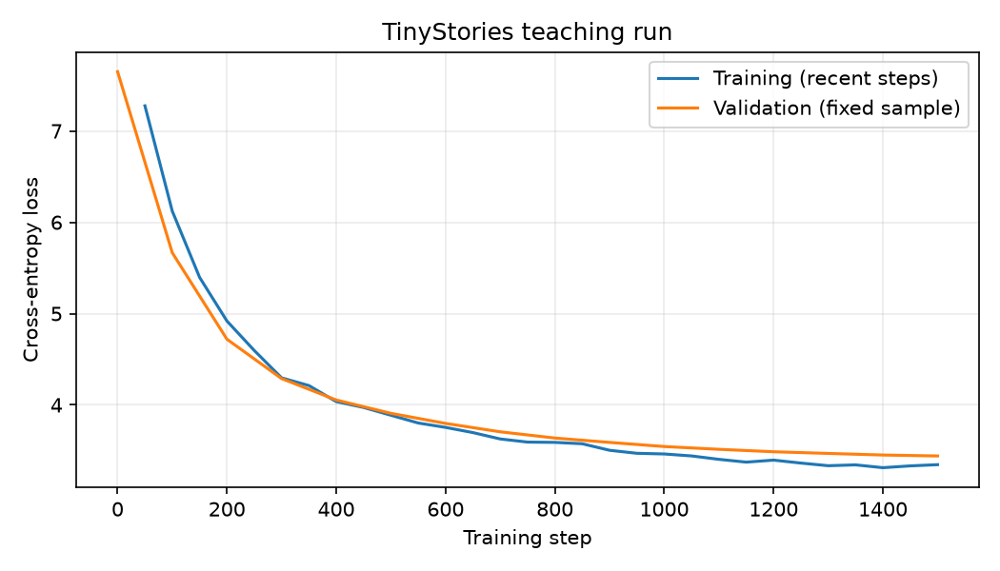

# assignment1-practice

一个用于学习的端到端语言模型实践：**真实文本 → 字节级BPE → 小型Transformer训练 → 保存权重 → 重新加载并生成文字**。

参考[Diy-LLM配套作业](https://github.com/datawhalechina/diy-llm)，使用Hugging Face `tokenizers`和PyTorch标准组件。脚本由AI辅助教学编写与检查，学习者在本地亲自运行数据处理、训练和生成。它不是原版CS336全部从零实现、实验及书面题的提交。

## 本次真实结果

| 项目 | 结果 |
| --- | ---: |
| 训练 / 验证故事 | 1800 / 200 |
| BPE词表大小 | 2048 |
| 训练 / 验证数据token | 393281 / 42866 |
| 模型参数量 | 950912 |
| 训练步数 | 1500 |
| 处理的训练token | 1536000 |
| 初始采样验证loss | 7.6494 |
| 最佳采样验证loss | 3.4412 |
| 最佳采样验证PPL | 31.2257 |
| 训练与验证循环耗时 | 约59.08秒 |
| 实际设备 | CPU，4线程 |

以上为学习者本次quickstart运行。PPL为exp(loss)，使用固定种子的采样验证窗口估计，并非对全部验证token逐个求得。计时不包括Python启动、模型初始化和最终画图；不代表其他硬件的性能。



生成样例开头：

```text
Once upon a time there was a little bird named Lily. He had a beautiful ball.
```

完整原始输出见[generated.txt](results/generated.txt)，包含语法错误、人物/情节混乱以及截断句子。小模型只验证真实的训练与生成流程，不宣称高质量故事生成。

## 项目文件

```text
prepare.py           文档划分、BPE训练、保存重载检查和token编码
model.py             pre-norm Transformer：RMSNorm、RoPE、SwiGLU、因果注意力
train.py             下一token训练、固定验证采样、日志、权重与曲线
generate.py          从匹配的checkpoint和分词器生成
requirements.txt     本次环境使用的依赖版本
tests/               10项自动检查
results/             本次训练汇总、日志、曲线及真实生成结果
lesson*.py           入门时的动手练习，部分故意触发编码错误
```

数据、虚拟环境和checkpoint是生成文件，默认不放进Git；`results/`保留较小的展示和复核材料。

## 复现流程（Windows PowerShell）

先进入解压或克隆后的项目目录。可以复用已配置的Python环境，或者新建虚拟环境：

```powershell
python -m venv .venv
& '.\.venv\Scripts\python.exe' -m pip install -r requirements.txt
```

当前已验证环境为Python 3.12.4、PyTorch 2.14.0+cpu、NumPy 2.5.3、tokenizers 0.23.3和matplotlib 3.11.2。CPU/CUDA构建及安装来源需与本机匹配；本项目没有验证CUDA执行。

### 1. 准备真实文本并训练BPE

准备以`<|endoftext|>`分隔故事的UTF-8文本，然后指定文件路径：

```powershell
& '.\.venv\Scripts\python.exe' '.\prepare.py' --source '你的故事文本文件路径'
```

默认去除空文档与重复文档，用随机种子42选择1800篇训练故事和200篇验证故事；BPE只在训练部分训练。它不标准化文本、不添加额外前缀空格，保留完整256字节初始字母表。

本次来源是本地配套文件`TinyStoriesV2-GPT4-valid.txt`。**将这个验证文件作为教学语料池重新划分，并不是原版官方训练/验证划分的标准实验。** 参考文件位于[配套仓库的本次版本](https://github.com/datawhalechina/diy-llm/blob/3afe8d3883167c1417d796f50c24e1f039f34a01/coursework/assignment1-basics/TinyStoriesV2-GPT4-valid.txt)，原数据项目为[TinyStories](https://huggingface.co/datasets/roneneldan/TinyStories)。

本机输入文件SHA-256：

```text
260119188ea4cd75966ec1cd860c0102112854f9890ca3d2bd157e8751926633
```

下载、Git检出或换行转换可能改变文件字节。精确复现需要相同源文件和运行环境；如果更换文本文件，词表和结果都会变化。每次准备数据都会保存来源哈希和配置到`data/manifest.json`。

输出`data/train.txt`、`val.txt`、`tokenizer.json`、`train.bin`、`val.bin`及`manifest.json`。二进制dtype为小端int32（`<i4`）。

### 2. 训练小模型

```powershell
& '.\.venv\Scripts\python.exe' '.\train.py' --steps 1500
```

默认模型：2层、128维、4头、上下文128、batch 8，学习率3e-4，50步warmup后余弦衰减。使用PyTorch标准层、交叉熵和AdamW。

每50步打印训练状态，每100步验证并保存，最后一步一定验证。输出在`checkpoints/quickstart/`：

- `best.pt` / `last.pt`：验证最优与最后一次的已训练权重。
- `metrics.jsonl` / `summary.json`：训练日志、配置、数据来源和结果。
- `loss.png`：训练与验证损失曲线。

训练会检查数据哈希、token范围和与分词器的完整解码一致性。验证批次来自独立验证集，不更新参数，不消耗训练采样随机数。

非空输出目录会被拒绝。再次训练请用新目录，例如`--out '.\checkpoints\run2'`；生成时也选择该目录的权重。本版保存优化器状态，但尚无`--resume`训练命令，不声称已验证断点续训。

### 3. 重新加载并生成

```powershell
& '.\.venv\Scripts\python.exe' '.\generate.py' --prompt 'Once upon a time'
```

默认加载`checkpoints/quickstart/best.pt`，检查分词器哈希，自动恢复模型配置。最多采样120个新token，temperature为0.8、top-k为40、seed为42，遇文档结束token可提前停止。

生成文本和参数保存到同一训练目录的`generated.txt`和`generated.json`。自定义训练目录时用`--checkpoint`指定权重。缺少权重不会改用随机模型。

### 4. 运行检查

```powershell
& '.\.venv\Scripts\python.exe' -m unittest discover -s tests -v
```

共10项检查：文档去重与分离、无损编码重载、二进制边界、无效输入拒绝、因果性、下一token目标、学习能力、短训练、权重重载以及损坏/不匹配数据拒绝。

## 来源与范围

- 课程与模型结构参考：Diy-LLM / CS336配套材料。
- BPE训练使用Hugging Face `tokenizers`，不声称手写库内BPE算法。
- 模型、训练和生成使用PyTorch标准组件；不满足原版限制直接调用标准层/损失/优化器的从零实现要求。
- 本仓库展示小规模教学实践，不包含OpenWebText大规模实验、全套消融实验、排行榜结果或原版全部书面题。
